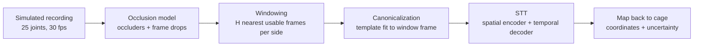

# Occlusion-Aware 3D Keypoint Tracking of Deformable Mice

Code for the M.Sc. thesis *"Occlusion-aware 3D keypoint tracking of deformable mice"* (Awsam Agbaria, Technische Universität Berlin, Computer Vision & Remote Sensing group, October 2026).

Multi-camera keypoint tracking can only recover a body part in 3D while at least two cameras see it. The gaps tend to appear exactly when the mouse interacts with objects, which is when behaviour analysis needs the data most. This repository contains a pipeline that **fills in the occluded 3D joints of a single mouse from the joints that are still visible over time**:

- a **structured occlusion model** that hides joints in spatial groups, over long stretches of time and in bursts of dropped frames, calibrated to a target occlusion ratio ρ;
- an **occlusion-robust canonicalization** (a weighted SE(2) template fit) that makes the whole pipeline exactly SE(2)-equivariant;
- a **Spatio-Temporal Transformer (STT)** that sees only the visible joints, keeps the center frame at per-joint resolution, compresses its context frames, and predicts the occluded joints with heteroscedastic (per-joint, per-axis) uncertainties.

On simulated recordings at ρ = 0.5, STT completes occluded joints with a mean error of **1.17 mm**. That is 69 % below a temporal CNN that receives hidden joints as zeros, and 72 % below the best non-learned baseline.

> **Scope.** All experiments use synthetic data with a perfect keypoint detector and exact triangulation. The results compare design choices under controlled conditions; whether they hold on real recordings still has to be tested.

---

## Contents

- [How it works](#how-it-works)
- [Results](#results)
- [Repository layout](#repository-layout)
- [Installation](#installation)
- [Data](#data)
- [Training](#training)
- [Evaluation](#evaluation)
- [Limitations](#limitations)
- [Citation](#citation)
- [Acknowledgements](#acknowledgements)
- [AI disclosure](#ai-disclosure)

---

## How it works



**1. Data.** A procedural simulator ([hellwich/mouseModel](https://github.com/hellwich/mouseModel)) moves a 25-joint mouse skeleton (plus a non-physical root joint) around a 1000 × 1000 mm cage at 30 fps. It exports complete 3D ground truth for every joint in every frame, together with per-frame behaviour labels.

**2. Occlusions** (`OAT/masker.py`). The cage contains no physical objects, so masks are generated stochastically while keeping the statistics of line-of-sight occlusion:
- *World occluders*: invisible balls fixed in cage coordinates and anchored on the animal's path. They hide every joint inside them. Their lifetimes and radii are log-normal (heavy-tailed), and they are placed per distance travelled rather than per second, so the hidden fraction barely depends on running speed.
- *Frame drops*: bursts of frames in which every joint is hidden. Frames with fewer than 3 visible joints are also treated as dropped.
- The occluder rate is scaled by one intensity α, which is found by bisection so that the hidden fraction matches a target ratio ρ. During training, ρ follows a curriculum from 0.4 to 0.7, and a new occlusion field is drawn every epoch.

**3. Windowing** (`OAT/wrapper.py`). Each center frame gets a window of 2H + 1 slots. Instead of using the immediate neighbours, the window collects the **H nearest usable (non-dropped) frames on each side** within a search radius Δmax, and records each frame's signed offset. Reference setting: H = 32, Δmax = 64 frames (≈ 2.1 s).

**4. Canonicalization** (`OAT/pose_extraction.py`). A reference skeleton (template) and per-joint reliability weights are fitted once on the training recording. Every frame's body frame (yaw and floor position) then comes from a **weighted rigid Procrustes fit of the template to the visible joints only**. Inside a window, the per-frame fits are merged into one shared *window frame*, weighted by temporal distance and by a heading confidence based on Fisher information. Because the estimated frame moves with the input, the model

$$M(x) = E(x)\cdot f\big(E(x)^{-1}\cdot x\big)$$

is exactly SE(2)-equivariant, whatever the network f is. Coordinates are then divided by a single isotropic scale (the 99.5th percentile of visible-joint distances, 274.34 mm in the thesis).

**5. Spatio-Temporal Transformer** (`OAT/models.py`, `OAT/modules.py`).
- *Spatial encoder* (shared across all slots): each **visible** joint becomes one token (coordinate embedding + joint-identity embedding). Hidden joints are left out entirely, never zero-filled. Three self-attention blocks are followed by pooling by multi-head attention (PMA), which gives one latent per frame. Slots with no visible joints use a learned *no-evidence* token.
- *Temporal decoder*: N learned queries, one per joint. Each of the 6 blocks runs self-attention over the queries together with the center frame's per-joint tokens, then cross-attention to the context-frame latents tagged with learned offset embeddings, then an MLP. Because each context frame is compressed to one latent, cost grows linearly with the window length.
- *Heads*: 3D coordinates for all joints (visible joints are overwritten with their observations) and a per-axis log σ.

**6. Objective** (`OAT/loss.py`). β-NLL ([Seitzer et al., 2022](https://arxiv.org/abs/2203.09168)) with β = 0.5, averaged over all occluded joints of the center frames. The model is selected on validation MPJPE using EMA weights.

---

## Results

Standard test tier (ρ = 0.5), three held-out simulated recordings × three occlusion seeds. Errors are in mm over the occluded joints of the center frame. *Present* and *dropped* split center frames that still have visible joints from frames that were dropped entirely.

| Method | Temporal | Learned | MPJPE | present | dropped | P90 | PCK@2mm (%) |
|---|:-:|:-:|---:|---:|---:|---:|---:|
| TP – template pose | | fitted | 6.72 | 3.70 | 17.01 | 13.53 | 36.3 |
| LI – linear interpolation | ✓ | | 8.73 | 7.26 | 13.75 | 21.02 | 32.1 |
| BFI – body-frame interpolation | ✓ | | 6.88 | 3.87 | 17.09 | 14.81 | 35.6 |
| NN – nearest-neighbour retrieval | | fitted | 4.26 | 0.51 | 17.01 | 12.18 | 73.8 |
| ST – STT with H = 0 | | ✓ | 5.36 | 1.93 | 17.01 | 11.87 | 37.6 |
| TCNN – dilated temporal CNN | ✓ | ✓ | 3.76 | 2.15 | 9.22 | 7.50 | 52.2 |
| **STT (ours)** | ✓ | ✓ | **1.17** | **0.28** | **4.22** | **1.27** | **93.2** |

Key findings:
- **Temporal context matters most.** Removing it (ST) makes the error on partially visible frames seven times larger (0.28 → 1.93 mm).
- **Leaving hidden joints out works better than zero-filling them.** With a similar parameter count (11.2 M vs. 11.3 M), STT's error is 69 % lower than TCNN's, and its trajectories are smoother and more anatomically plausible.
- **Robust within the training range.** On the ratio sweep, STT's error rises only from 0.67 mm to 0.87 mm for ρ = 0.4 to 0.7.
- **Dropped frames are the open problem.** They make up 23 % of scored joints but cause 82 % of the error. The posture is recovered well; the error comes from placing the whole body along its heading.
- **Ablations.** Precision-weighted objectives (β ∈ {0, 0.5}) are 5–6× more accurate than β = 1 or plain MSE. A window of H = 16 performed better than the reference H = 32 in every column of the window-length ablation.

STT runs at about 2.2 ms per window (batch 256, RTX 4070 Laptop GPU). One training run takes about 6 GPU-hours with 2.3 GiB peak memory. See Chapter 5 and Appendix E of the thesis for the full tables.

---

## Repository layout

```
DeformableMouseTracking/
├── environment.yml  # snapshots of the author's environment (see Installation)
└── src/
    ├── train.py                 # Hydra entry point
    ├── registry.py              # experiment registry; builds data, occlusion, model, loss, trainer
    ├── OAT/
    │   ├── dataset.py           # RawDataset: CSV loading, skeleton, template + joint-weight fit
    │   ├── masker.py            # RecordingOcclusion: occluders, frame drops, ratio calibration, curriculum
    │   ├── wrapper.py           # TemporalWrapper: windowing, window frame, normalization, samples
    │   ├── pose_extraction.py   # SE(2) utilities, weighted Procrustes, template fit, window-frame fusion
    │   ├── models.py            # STT (SnapshotEncoder + TemporalDecoder), global-attention variant
    │   ├── modules.py           # attention / pooling / decoder / dilated-conv building blocks
    │   ├── baselines.py         # TemporalCNN (TCNN baseline)
    │   ├── loss.py              # β-NLL / MSE keypoint loss and metrics
    │   └── trainer.py           # training loop, EMA, early stopping, checkpoints, reports, plots
    └── configs/
        ├── config.yaml
        ├── training/            # one file per trained model
```

---

## Installation

The thesis experiments ran with **Python 3.12** and **PyTorch 2.9.1 (CUDA 12.8)** on Linux. The code only needs a few packages:

```bash
git clone https://github.com/AwsamAgbarya/DeformableMouseTracking.git
cd DeformableMouseTracking

conda create -n mousetrack python=3.12 -y
conda activate mousetrack

# Choose the PyTorch build that matches your CUDA version: https://pytorch.org/get-started/locally/
pip install torch==2.9.1 --index-url https://download.pytorch.org/whl/cu128
pip install hydra-core omegaconf numpy pandas matplotlib
pip install wandb          # optional, for experiment logging
```

`environment.yml` are full exports of the author's environment.

---

## Data

The recordings come from the simulator at [hellwich/mouseModel](https://github.com/hellwich/mouseModel) and are not included in this repository. Configs resolve paths relative to `src/`, so place the files in a top-level `data/` folder:

```
data/
├── glob3DBodyParts.csv   glob3DBodyParts_frames.csv   # training   (20,000 frames)
├── valid.csv             valid_frames.csv             # validation  (5,000 frames)
└── test1.csv … test3.csv test1_frames.csv …           # test       (10,000 frames each)
```

**Recording CSV:** long format, one row per (frame, joint), with every joint present in every frame. Units are mm.

| Column | Meaning |
|---|---|
| `time` | timestamp of the frame |
| `part` | joint name (see below), including the non-physical root `base` |
| `x_d, y_d, z_d` | deformable world coordinates — the ground truth that is occluded and predicted |
| `x_r, y_r, z_r` | rigid world coordinates (rest pose under the global motion only) |
| `x_l, y_l, z_l` | local deformation in the body frame |

`frame` and `joint_id` columns are allowed and ignored. Joint names: `base, spine_base, spine_mid, spine_front, neck, head, nose, ear_l, ear_r, shoulder_l, elbow_l, wrist_l, shoulder_r, elbow_r, wrist_r, hip_l, knee_l, ankle_l, hindpaw_l, hip_r, knee_r, ankle_r, hindpaw_r, tail_base, tail_mid, tail_end`.

**Frames CSV (optional):** one row per frame with optional `loco_clip` (locomotion mode) and `ovl_clip` (behaviour overlay) columns. These labels are used for the per-behaviour error breakdown. If you don't have one, remove the `frames_file` entries from the config (or pass `~train_dataset.frames_file ~validation_dataset.frames_file`).

---

## Training

Run everything from `src/`. Each file in `configs/training/` is a complete Hydra config:

```bash
cd src
python train.py --config-name training/temporal_32
```

| Config | Model | Notes |
|---|---|---|
| `temporal_32.yaml` | **STT** (reference) | H = 32, Δmax = 64, full-context training windows |
| `temporal_32_notfull.yaml` | STT | also trains on padded windows (`require_full_context: False`) |
| `no_temporal.yaml` | **ST** | single frame (H = 0), dropped centers excluded |
| `temporal_cnn.yaml` | **TCNN** | `model.type: tcn`, 832 channels, dilations 1/3/9/27 |

Any value can be overridden on the command line:

```bash
# another seed (the run name becomes temporal_32_s43)
python train.py --config-name training/temporal_32 experiment.seed=43

# no Weights & Biases, fewer dataloader workers
python train.py --config-name training/temporal_32 training.use_wandb=false training.dataloader.num_workers=2

# window-length ablation (H = 16, Δmax = 32)
python train.py --config-name training/temporal_32 experiment.name=temporal_16 \
    train_dataset.T_half=16 train_dataset.max_radius=32 \
    validation_dataset.T_half=16 validation_dataset.max_radius=32

# objective ablations
python train.py --config-name training/temporal_32 experiment.name=beta_0 loss.beta_nll=0.0
python train.py --config-name training/temporal_32 experiment.name=mse \
    loss.use_uncertainty=false model.decoder.predict_uncertainty=false

# resume
python train.py --config-name training/temporal_32 training.resume_from=../checkpoints/OAT/temporal_32_s42/latest.pt
```

Other useful settings: `model.type` (`transformer` | `global` | `tcn`), `masker.mode` (`world` | `iid` for the unstructured control), `masker.curriculum.*`, `val_masker.target_ratio`, and `train_dataset.canonicalization` (`window` | `per_frame`).

Training uses CUDA when it is available and falls back to the CPU otherwise. `use_wandb` is `True` in the provided configs. Either run `wandb login` first or turn it off as shown above. If `wandb` isn't installed, logging is skipped automatically.

**Outputs** are written to `checkpoints/OAT/<experiment.name>_s<seed>/`:

| File | Content |
|---|---|
| `config.yaml` | the fully composed config of the run |
| `train.log` | training log |
| `best.pt` | checkpoint with the lowest validation MPJPE (selection metric) |
| `latest.pt`, `final.pt` | periodic (every 5 epochs) and last checkpoint |
| `val_vis_epoch_XXXX.png` | best, median and worst validation reconstructions (top and side views) every 10 epochs |
| `final_report.json`, `final_report.md` | validation metrics of the best model, broken down by condition and by joint |

---

## Limitations

- **Synthetic setting only.** The cage is empty, occlusions are sampled rather than ray-traced, self-occlusion isn't modelled, and the behaviour set is limited (no rearing, grooming or social interaction). Detections are assumed exact, so visible joints are copied straight into the prediction.
- **Padded windows** (near recording boundaries or long drop bursts) are excluded from training but have to be completed at test time, so the model sees them out of distribution.
- **Single template.** A single average planar pose suits a mouse moving on the floor but would struggle with postures such as rearing.
- **Single training seed per model.** Small differences between configurations were not tested for significance.

---

## Citation

```bibtex
@mastersthesis{agbaria2026occlusion,
  author = {Agbaria, Awsam},
  title  = {Occlusion-aware 3D keypoint tracking of deformable mice},
  school = {Technische Universit{\"a}t Berlin},
  type   = {Master's thesis},
  year   = {2026},
  month  = oct
}
```

## Acknowledgements

This thesis was supervised by Prof. Dr.-Ing. Olaf Hellwich and M.Sc. Soledad Traverso at the Computer Vision & Remote Sensing group, TU Berlin. The mouse simulator is maintained at [hellwich/mouseModel](https://github.com/hellwich/mouseModel).

---

## AI disclosure

This README was generated with AI (Anthropic's Claude Opus 5.5), based on the thesis and the source code in this repository. The thesis is the authoritative description of the method and results.
